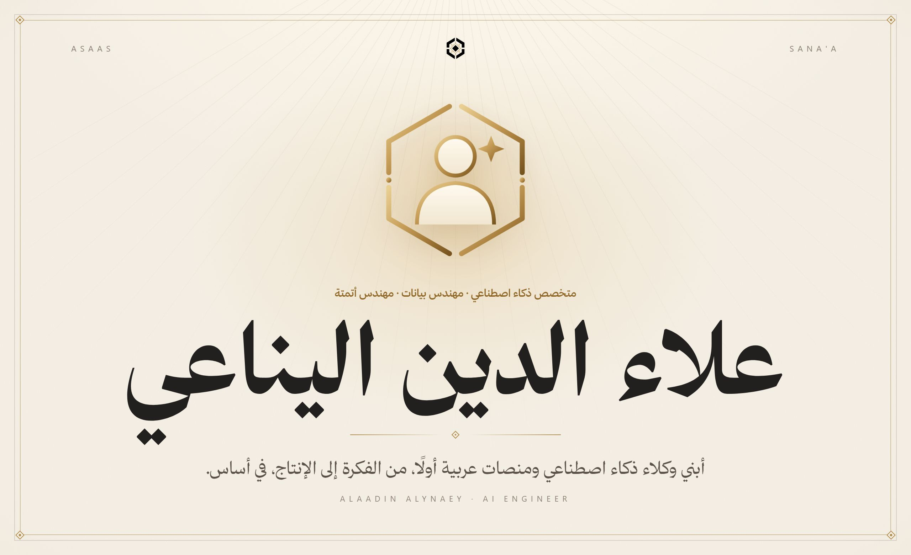
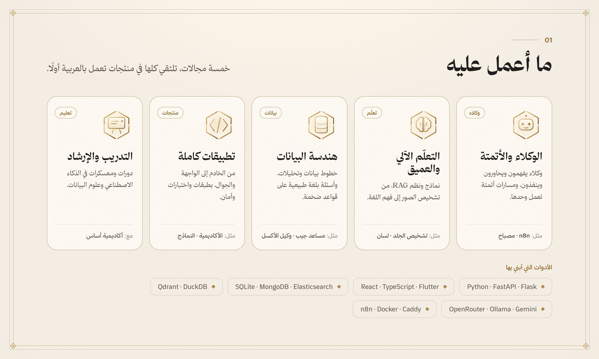
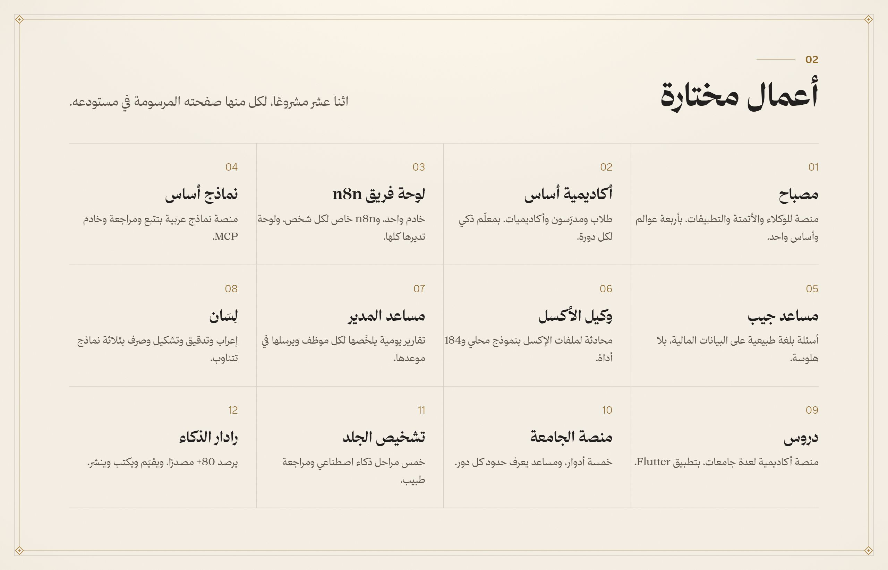
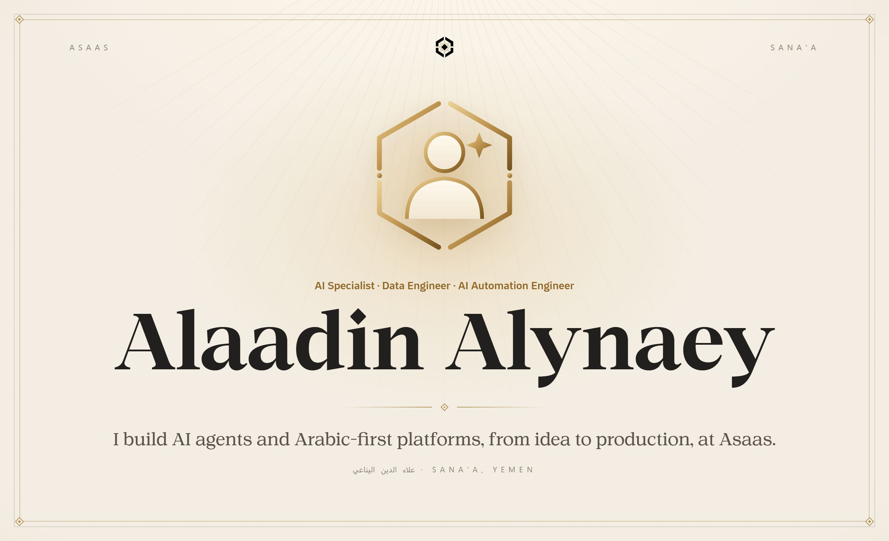
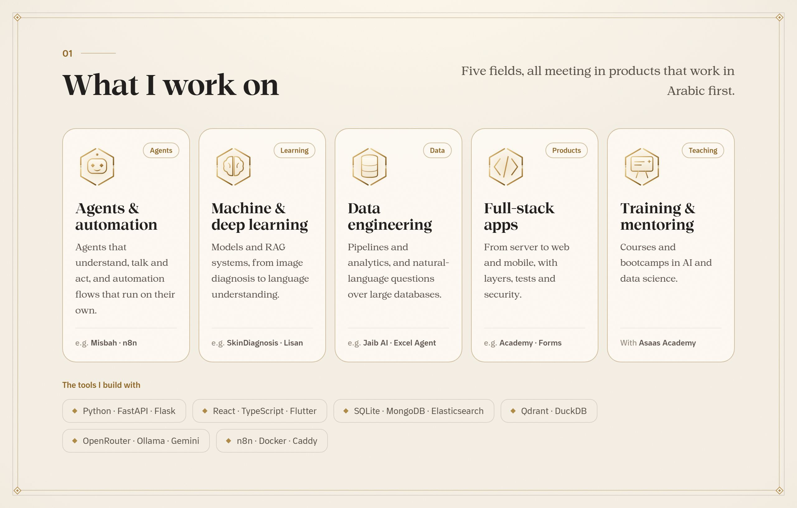
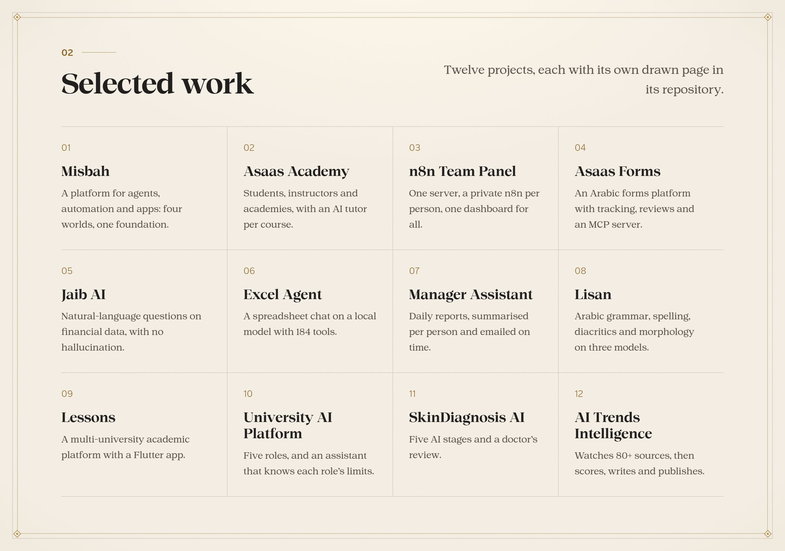

<b>العربية</b> · <a href="#english">English</a>

 

<a href="https://alaadin-alynaey.site">الموقع الشخصي</a> &nbsp;·&nbsp; <a href="https://ai-asaas.com">أساس</a> &nbsp;·&nbsp; <a href="https://www.linkedin.com/in/alaadin-al-ynaey-179a88342">LINKEDIN</a> &nbsp;·&nbsp; <a href="https://alaadin-alynaey.site/blog">المدونة</a> &nbsp;·&nbsp; <a href="mailto:alaadinalynaey@gmail.com">تواصل</a>

أبني في **أساس** منصات ذكاء اصطناعي عربية أولًا: وكلاء يفكّرون ويحاورون، وأتمتة تنفّذ، ومنصات تعليم ونماذج وبيانات تعمل في الإنتاج. وأدرّب وأرشد في الذكاء الاصطناعي وعلوم البيانات.

 

 

## النشاط

<picture><source media="(prefers-color-scheme: dark)" srcset="https://raw.githubusercontent.com/AladdinAlynaey/AladdinAlynaey/output/snake-dark.svg"></picture>

## كل المشاريع

المستودعات الخاصة تفتح على واجهة عرضها العامة.

| المشروع | ما هو |
|---|---|
| [مصباح](https://github.com/AladdinAlynaey/misbah-private) | منصة الوكلاء والأتمتة والتطبيقات |
| [أكاديمية أساس](https://github.com/AladdinAlynaey/asaas_academy-private) | منصة التعليم العربية |
| [لوحة فريق n8n](https://github.com/AladdinAlynaey/n8n-team-panel-private) | n8n خاص لكل شخص في الفريق |
| [نماذج أساس](https://github.com/AladdinAlynaey/asaas-forms-private) | منصة النماذج العربية |
| [مساعد جيب](https://github.com/AladdinAlynaey/jaib_assistant-private) | تحليل البيانات المالية بلغة طبيعية |
| [وكيل الأكسل](https://github.com/AladdinAlynaey/jaib-excel-agent-private) | محادثة لملفات الإكسل بنموذج محلي |
| [مساعد المدير](https://github.com/AladdinAlynaey/summarize-agent-private) | التقارير اليومية وملخصاتها |
| [لِسَان](https://github.com/AladdinAlynaey/lisan) | ذكاء اصطناعي للغة العربية |
| [بوابة لسان](https://github.com/AladdinAlynaey/lisan-auth-private) | الحسابات والرصيد في لسان |
| [دروس](https://github.com/AladdinAlynaey/Lessons-Academic-Platform-private) | منصة أكاديمية لعدة جامعات |
| [منصة الجامعة](https://github.com/AladdinAlynaey/uniwebsite_private) | نظام جامعي بخمسة أدوار |
| [تشخيص الجلد](https://github.com/AladdinAlynaey/SkinApp) | تشخيص أمراض الجلد بالذكاء الاصطناعي |
| [رادار الذكاء](https://github.com/AladdinAlynaey/ai-trends-intelligence) | رصد أخبار الذكاء الاصطناعي ونشرها |
| [بودكاست المستندات](https://github.com/AladdinAlynaey/podcastapp) | من المستند إلى بودكاست |
| [محوّل اللوحة](https://github.com/AladdinAlynaey/keyboard-converter) | تصحيح النص المكتوب بلوحة خاطئة |
| [ملعب HTTP](https://github.com/AladdinAlynaey/http-testing) | تدريب على HTTP والواجهات البرمجية |
| [تاسكورا](https://github.com/AladdinAlynaey/taskora_private) | إدارة المشاريع للمؤسسات |
| [متجر علاء الدين](https://github.com/AladdinAlynaey/Alaadin_E-commerce) | متجر ملابس بموقع وتطبيق |
| [ليالي المافيا](https://github.com/AladdinAlynaey/Mafia_Game-private) | لعبة المافيا على جهاز واحد |
| [موقع أساس](https://github.com/AladdinAlynaey/asaas_website-private) | الموقع الرسمي لأساس |
| [موقعي الشخصي](https://github.com/AladdinAlynaey/my_new_website-private) | alaadin-alynaey.site |
| [مشاريعي](https://github.com/AladdinAlynaey/alaadin-projects) | معرض المشاريع |
| [منصة الأكاديمية](https://github.com/AladdinAlynaey/academy-platform-private) | الإصدار الأول من الأكاديمية |
| [ملفي الشخصي](https://github.com/AladdinAlynaey/My_Profile-private) | الملف الشخصي الأول |

<a href="#arabic">العربية</a> · <b>English</b>

 

<a href="https://alaadin-alynaey.site">PORTFOLIO</a> &nbsp;·&nbsp; <a href="https://ai-asaas.com">ASAAS</a> &nbsp;·&nbsp; <a href="https://www.linkedin.com/in/alaadin-al-ynaey-179a88342">LINKEDIN</a> &nbsp;·&nbsp; <a href="https://alaadin-alynaey.site/blog">WRITING</a> &nbsp;·&nbsp; <a href="mailto:alaadinalynaey@gmail.com">CONTACT</a>

At **Asaas** I build Arabic-first AI platforms: agents that think and talk, automation that executes, and learning, forms and data platforms that run in production. I also train and mentor in AI and data science.

 

 

## Activity

<picture><source media="(prefers-color-scheme: dark)" srcset="https://raw.githubusercontent.com/AladdinAlynaey/AladdinAlynaey/output/snake-dark.svg"></picture>

## Every project

Private repositories open on their public showcase.

| Project | What it is |
|---|---|
| [Misbah](https://github.com/AladdinAlynaey/misbah-private) | Agents, automation and apps platform |
| [Asaas Academy](https://github.com/AladdinAlynaey/asaas_academy-private) | The Arabic learning platform |
| [n8n Team Panel](https://github.com/AladdinAlynaey/n8n-team-panel-private) | A private n8n per teammate |
| [Asaas Forms](https://github.com/AladdinAlynaey/asaas-forms-private) | The Arabic forms platform |
| [Jaib AI](https://github.com/AladdinAlynaey/jaib_assistant-private) | Natural-language financial analytics |
| [Excel Agent](https://github.com/AladdinAlynaey/jaib-excel-agent-private) | A local-LLM spreadsheet chat |
| [Manager Assistant](https://github.com/AladdinAlynaey/summarize-agent-private) | Daily reports and their digests |
| [Lisan](https://github.com/AladdinAlynaey/lisan) | AI for the Arabic language |
| [Lisan Auth](https://github.com/AladdinAlynaey/lisan-auth-private) | Accounts and credits for Lisan |
| [Lessons](https://github.com/AladdinAlynaey/Lessons-Academic-Platform-private) | A multi-university academic platform |
| [University AI Platform](https://github.com/AladdinAlynaey/uniwebsite_private) | A five-role university system |
| [SkinDiagnosis AI](https://github.com/AladdinAlynaey/SkinApp) | AI skin disease diagnosis |
| [AI Trends Intelligence](https://github.com/AladdinAlynaey/ai-trends-intelligence) | AI news monitoring and publishing |
| [DocsPodcast](https://github.com/AladdinAlynaey/podcastapp) | From a document to a podcast |
| [Keyboard Converter](https://github.com/AladdinAlynaey/keyboard-converter) | Fixing wrong-layout text |
| [HTTP Playground](https://github.com/AladdinAlynaey/http-testing) | HTTP and API training |
| [Taskora](https://github.com/AladdinAlynaey/taskora_private) | Enterprise project management |
| [Alaadin Store](https://github.com/AladdinAlynaey/Alaadin_E-commerce) | A clothing store, web and mobile |
| [Mafia Nights](https://github.com/AladdinAlynaey/Mafia_Game-private) | A pass-and-play party game |
| [Asaas website](https://github.com/AladdinAlynaey/asaas_website-private) | The official Asaas site |
| [Personal website](https://github.com/AladdinAlynaey/my_new_website-private) | alaadin-alynaey.site |
| [My Projects](https://github.com/AladdinAlynaey/alaadin-projects) | The project gallery |
| [Academy Platform](https://github.com/AladdinAlynaey/academy-platform-private) | The Academy’s first version |
| [My Profile](https://github.com/AladdinAlynaey/My_Profile-private) | The first personal profile |

  جزء من منظومة <b>أساس</b> · Part of the <b>Asaas</b> ecosystem
   
  من تصميم وبناء <a href="https://github.com/AladdinAlynaey">علاء الدين اليناعي</a> · Designed and built by <a href="https://github.com/AladdinAlynaey">Alaadin Alynaey</a>
   
  © 2026 · جميع الحقوق محفوظة · All rights reserved

